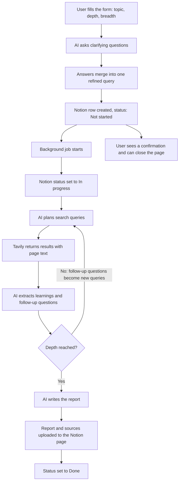

<div align="center">

# DeepResearcher

### An n8n workflow that researches a topic on the web and writes the report into Notion

<br>

[](https://n8n.io)
[](https://www.notion.so)
[](https://tavily.com)
[](https://ai.google.dev)
[](#status-and-roadmap)

<br>

[Overview](#overview) &nbsp;·&nbsp;
[How it works](#how-it-works) &nbsp;·&nbsp;
[Setup](#setup) &nbsp;·&nbsp;
[Usage](#usage) &nbsp;·&nbsp;
[Workflow map](#workflow-map) &nbsp;·&nbsp;
[Troubleshooting](#troubleshooting)

</div>

---

## Overview

Researching a topic by hand means searching, opening a dozen tabs, reading each page, and writing up what matters. DeepResearcher automates that loop. You submit a topic through a web form, answer a few clarifying questions, and close the page. The workflow keeps running on the n8n server, searches the web in several rounds, and saves a finished report with its sources to a Notion database.

It is modelled on the "deep research" feature offered by some commercial AI products, but every part is open: you can change the AI models, the search provider and the output destination by editing nodes.

**What you get**

- A web form that takes the topic plus how deep and how wide the research should go
- AI-written clarifying questions that narrow the topic before any searching starts
- A Notion page for each request, with a status that moves from Not started to In progress to Done
- A background job, so nobody has to keep a browser tab open
- A recursive research loop: each round's follow-up questions become the next round's searches
- A final report in Notion with a list of every source URL used

---

## How it works



The workflow calls itself. A router node reads a `jobType` value and sends each call down one of three paths.

| jobType | What it does |
|---|---|
| `deepresearch_initiate` | Marks the Notion row In progress and starts the loop |
| `deepresearch_learnings` | Runs one research round: plan queries, search, read pages, extract learnings |
| `deepresearch_report` | Writes the report from all collected learnings and publishes it to Notion |

### Depth and breadth

Two settings on the form control how much work a run does.

| Setting | Options | Effect |
|---|---|---|
| Depth | 0 to 3 | Number of follow-up rounds after the first one. Depth 1 means two rounds in total |
| Breadth | 1 to 5 | Number of search queries planned in each round |

Cost and time grow quickly as both numbers go up, because every query triggers a search and an AI call. Depth 1 with breadth 2 is a good first test and usually finishes in minutes. Depth 3 with breadth 5 can take hours.

---

## Tech stack

| Layer | Tool |
|---|---|
| Orchestration, forms, looping | n8n |
| Clarifying questions, search planning, formatting | Google Gemini or Groq |
| Learning extraction and report writing | An OpenAI-compatible chat model (Kimi K3 through NVIDIA's API, or OpenAI) |
| Web search and page text | Tavily Search API |
| Storage and status tracking | Notion database and API |
| Reliable AI output | n8n Structured Output Parser (JSON schemas) |

The model nodes are ordinary n8n chat model nodes, so swapping one provider for another only means changing the credential and model name on that node.

---

## Setup

### Prerequisites

- An n8n instance, either n8n Cloud or self-hosted
- A Notion account
- A Tavily API key (a free tier is available)
- An API key for the chat models you plan to use

### 1. Create the Notion database

Create a database with exactly these properties. The names must match, because the workflow filters and updates by name.

| Property | Type |
|---|---|
| Name | Title |
| Description | Text |
| Status | Status, with the options Not started, In progress and Done |
| Request ID | Text |
| Last Updated | Date |

Then create a Notion integration at `notion.so/my-integrations`, copy its secret, open the database, and add the integration under the page menu, Connections. Without this step n8n cannot see the database.

### 2. Import the workflow

In n8n, choose Import from File and select `workflow/deepresearcher.json`.

### 3. Add credentials

| Credential | Used by |
|---|---|
| Notion API | Create Row, Get Existing Row, Set In-Progress, Set Done, and the upload nodes |
| Bearer Auth (Tavily key) | Web Search |
| Google Gemini or Groq | The chat model nodes on the query, clarifying question and formatting steps |
| OpenAI API (set the Base URL to `https://integrate.api.nvidia.com/v1` when using NVIDIA) | The chat model nodes on DeepResearch Learnings and Generate Report |

Credentials live in n8n, not in the exported JSON, so the workflow file contains no secrets.

### 4. Point the Notion nodes at your database

Open each Notion node and select your database from the list. Check that the property names match the table above.

### 5. Publish the workflow

Publish it before the first real run. The workflow starts new runs of itself, and n8n refuses to do that for an unpublished workflow. After any later edit, publish again, because background runs use the published version.

---

## Usage

1. Open the form URL. For a test run, click Execute workflow in n8n and use the Test URL on the form trigger. For normal use, open `https://<your-n8n-host>/form/deep_research`.
2. Enter a topic and choose depth and breadth.
3. Answer the clarifying questions, tick the consent box, and submit.
4. Close the page if you like. The research continues on the server.
5. Watch the Notion database. The new row changes to In progress and then to Done, and the report fills the page.

To follow a run in detail, open the Executions tab in n8n. The background job appears there as its own runs, separate from the form run.

---

## Workflow map

The canvas is split into numbered sections.

<details>
<summary>Form and setup (sections 1 to 4)</summary>

<br>

| Section | Purpose |
|---|---|
| 1. Let's Research | Form trigger and the request form |
| 2. Ask Clarifying Questions | The AI writes up to three questions, and a loop collects the answers |
| 3. Create Empty Report Page in Notion | The AI writes a title and description, and a row is created in Notion |
| 4. Trigger DeepResearch Asynchronously | Starts the background job and shows the confirmation page |

</details>

<details>
<summary>Research loop (sections 5 to 9)</summary>

<br>

| Section | Purpose |
|---|---|
| 5. Set Report to In-Progress | Finds the Notion row by Request ID and updates its status |
| 6. Perform DeepSearch Loop | Accumulates learnings, checks the depth, and prepares the next round |
| 7. Generate Search Queries | The AI plans one search per angle, up to the breadth setting |
| 8. Web Search and Extracting Page Contents | Tavily search, then filters that drop empty or failed pages |
| 9. Compile Learnings | The AI reads the pages and returns up to three facts and follow-up questions per query |

</details>

<details>
<summary>Report and delivery (sections 10 to 13)</summary>

<br>

| Section | Purpose |
|---|---|
| 10. Generate Report | The AI writes the full report from all learnings |
| 11. Reformat Report as Notion Blocks | Markdown is converted to HTML, split into chunks, and turned into Notion blocks |
| 12. Append URL Sources List | Every source URL is added as a list at the end |
| 13. Update Report in Notion | Blocks are uploaded to the page and the status is set to Done |

</details>

A failed search never stops a run. If Tavily errors, returns nothing, or every page is filtered out, an Empty Response node supplies empty results and the loop continues.

---

## Troubleshooting

| Symptom | Likely cause and fix |
|---|---|
| "Workflow is not active and cannot be executed" | The workflow is not published. Publish it, then run a new test |
| Notion row stays on Not started | The background run failed early. Open the Executions tab, check Set In-Progress, and confirm the Notion integration is connected to the database |
| Depth and breadth seem ignored | The form field labels must be exactly `Research Depth` and `Research Breadth`, because the Set Variables node reads them by name |
| Web Search returns 401 | The Tavily key is wrong. Paste the key alone into the Bearer credential, without the word Bearer |
| Learnings or report step fails | Check the credential and the model name on the chat model node |
| Execution Data shows null values | The sub-workflow trigger was run by hand. Start from the form instead |
| Changes have no effect on the background run | Publish again after every edit |

---

## Limitations

- Report quality depends on what the search returns. Some sites block scrapers or return no text, and those pages are skipped.
- The AI can misread a page or state something wrong. Check the source list before relying on a claim.
- Search credits on a free Tavily plan can run out on deep, wide runs.
- The interface is n8n's built-in form. English is the only language tested, and PDF sources are not supported.

---

## Status and roadmap

The full pipeline is built, from form to report in Notion. It is a working prototype and is still being tested across different topics.

- [x] Form intake with depth and breadth dropdowns
- [x] Clarifying question loop
- [x] Notion row creation and status tracking
- [x] Background execution
- [x] Recursive search and learning loop with Tavily
- [x] Report generation and upload with a source list
- [ ] Testing across more topic types
- [ ] Better error handling and retries
- [ ] Custom front end in place of the n8n form
- [ ] Additional search providers
- [ ] Multi-language and PDF support
- [ ] Optional human review before a report is finalised

---

## Project structure

```
.
├── README.md
└── workflow/
    └── deepresearcher.json     # importable n8n workflow
```

---

## Acknowledgements

This project adapts the open n8n "DeepResearcher" template by Jim Le. The changes made here include replacing the Apify search and scraping steps with Tavily, switching the form to dropdown inputs, and configuring different AI model providers.

## Authors

Smruti Ranjan Nayak
